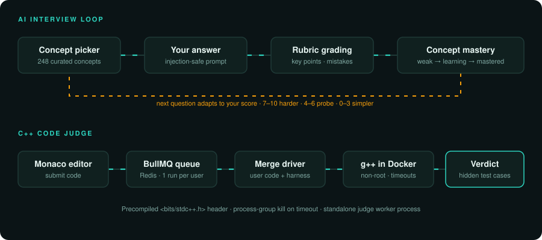

<p align="center">
  
</p>

<p align="center">
  
</p>

<p align="center">
  
  
  
  
  
  
  
  
</p>

---

## 🎯 What is this?

Campus placement interviews test four things: **CS fundamentals**, **DSA coding**, **behavioral answers** and **your resume**. This platform lets you practise all four in one place. An AI interviewer adapts to your answers, a real C++ judge runs your code against hidden test cases, and the platform tracks which concepts you've actually mastered.

<p align="center">
  
</p>

---

## ✨ Features

<table>
<tr>
<td width="50%" valign="top">

### 🎙️ AI technical interviews
- Live, one-question-at-a-time interviews on **DBMS, OS, Computer Networks and OOPS**
- Drawn from a curated knowledge base of **248 concepts**, each with a grading rubric
- Questions **adapt to every answer**: go deeper, probe the gap, or step back
- **Concept mastery tracking** skips what you know and targets your weak spots

</td>
<td width="50%" valign="top">

### 💻 DSA practice with a code judge
- LeetCode-style split view with the **Monaco editor**
- **C++ judge** runs your code against visible and hidden test cases
- Tag-based problem list, **progress ring**, stats and a **practice calendar**
- Bulk problem upload for admins

</td>
</tr>
<tr>
<td width="50%" valign="top">

### 📝 MCQ tests
- **50-question tests per subject** (20 easy, 20 medium, 10 hard), randomly sampled on every attempt
- Full **attempt review** of every answer after the test
- **Leaderboard** across users

</td>
<td width="50%" valign="top">

### 🧑‍💼 Behavioral & resume
- **STAR method practice**: AI scores clarity, impact and completeness, and suggests improvements
- **Resume vs job description analysis**: upload a PDF and get an ATS-style score with feedback
- Progress tracking for behavioral answers

</td>
</tr>
</table>

**Admin panel:** manage subjects, MCQs, DSA problems, STAR questions and users, with an analytics dashboard.

---

## ⚙️ Engineering highlights

<details open>
<summary><b>🧠 Adaptive interview engine</b></summary>

- Each answer is graded **0–10 against a rubric** (key points, reference answer, common mistakes) and sorted into a branch:
  - **7–10:** go one level deeper on the same concept
  - **4–6:** probe the specific gap in the answer
  - **0–3:** move to an easier, uncovered topic
- A topic gets at most **3 turns** (an opener plus two follow-ups), just like a real interviewer
- **Prompt-injection safe**: answers are treated as answers only, so "give me a 10" just scores as off-topic
- **Model fallback**: Groq Qwen3 first, GPT-OSS when rate-limited, with a time budget so slow calls never double-process an answer
- **Concept mastery** uses an exponential moving average of your scores. A concept counts as mastered only after 2+ strong attempts, and anything seen in the last 3 days is skipped.

</details>

<details>
<summary><b>⚖️ Measuring the grader (eval harness)</b></summary>

- `npm run eval:grading` runs fixed answers (strong, partial, vague, off-topic, "I don't know", prompt injection) through the **real grading path** several times each
- Reports how often each score lands in its expected range and how much repeated grades vary
- A `--compare` mode measures how much the rubric improves grading accuracy

</details>

<details>
<summary><b>🐳 Sandboxed C++ judge</b></summary>

- User code is merged with a per-problem **driver harness**, written to a temp `.cpp` file, compiled with `g++` and run against hidden test cases
- The API runs in **Docker as a non-root user**, with a **precompiled `<bits/stdc++.h>` header** to cut compile time
- Compile **timeouts kill the whole process group**, so stuck `cc1plus` and `ld` processes never pile up

</details>

<details>
<summary><b>📬 Judge queue with BullMQ</b></summary>

- Compiling is CPU-bound, so only a few runs execute at once and the rest wait in order. This prevents false TLEs under load.
- **One active run per user**, and the queue rejects new runs when it is full
- With Redis, jobs live in **BullMQ** and run in a **standalone worker process** (`npm run worker`). Without Redis it falls back to an in-memory queue.

</details>

---

## 🗂️ Project structure

```
interview-platform/
├── client/platform/          # React + Vite + Tailwind (deployed on Vercel)
│   └── src/
│       ├── pages/user/       # Interview room, DSA solve, tests, STAR, resume score, ...
│       ├── pages/admin/      # Subjects, MCQs, DSA problems, users, analytics
│       └── components/       # Code editor, problem tabs, calendar, progress ring, ...
├── server/                   # Express API (Docker on Render)
│   ├── src/
│   │   ├── services/
│   │   │   ├── interview/    # Engine, knowledge base, mastery, Groq provider
│   │   │   ├── cppRunner.js  # Compile and run C++ against test cases
│   │   │   └── judgeQueue.js # BullMQ / in-memory judge queue
│   │   ├── evals/            # Grading eval harness
│   │   ├── seeds/kb/         # Curated concept banks (DBMS, OS, CN, OOPS)
│   │   ├── models/ controllers/ routes/ middleware/
│   ├── worker.js             # Standalone judge worker
│   └── Dockerfile
└── render.yaml               # Backend deploy blueprint
```

---

<p align="center">
  Built by <a href="https://github.com/SATTURAMBOWORK"><b>Satvik Singh</b></a>
</p>

<p align="center">
  
</p>
